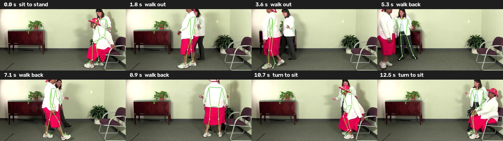
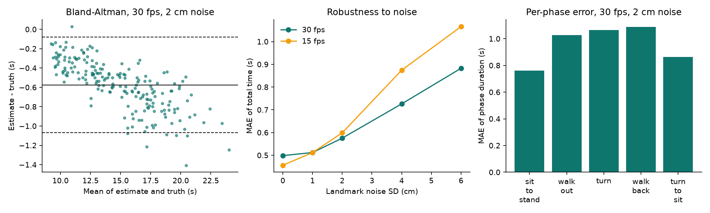

# StepSafe: video-based Timed Up and Go analysis for fall-risk screening

Times the CDC Timed Up and Go (TUG) test from an ordinary video using markerless pose
estimation, splits it into five phases, and measures steps, cadence and trunk lean. No
wearables and no markers.

> Research prototype for education. Not a medical device. Not clinically validated.



*Skeleton tracking and detected phases on the CDC STEADI demonstration video (public domain).*

## Headline results

**Simulation study** (2,000 simulated tests with known ground truth, 6 to 30 s long):

| Condition | Mean error | Mean absolute error | Sensitivity at 12 s | Specificity at 12 s |
|---|---|---|---|---|
| 30 fps, 2 cm landmark noise | -0.57 s | 0.58 s | 94.9% | 100% |
| 15 fps, 2 cm landmark noise | -0.60 s | 0.60 s | 96.6% | 100% |
| 15 fps, 6 cm landmark noise (worst case) | -1.06 s | 1.07 s | 93.1% | 100% |

The method reads about half a second short, consistently. It never flagged a simulated patient
who was under the 12-second cut-off, and it missed about 5% of those just over it.

**Real video** (one clip, CDC demonstration): measured 12.5 s, 14 steps, cadence 97 steps/min.
No reference stopwatch time is available for this clip, so this is a plausibility check, not
an accuracy figure. It also exposed the main practical limitation (below).



Details: [reports/REPORT.md](reports/REPORT.md) and [reports/RESULTS.md](reports/RESULTS.md).

## What it does

1. **Pose estimation**: MediaPipe Pose Landmarker, 33 landmarks per frame, 3-D world coordinates.
2. **Timing**: hip and knee joint angles separate sitting from standing; the test starts and
   ends where the rate of posture change crosses 10% of its peak.
3. **Phases**: sit-to-stand, walk out, turn, walk back, turn-and-sit. Turns come from travel
   across the image (video) or body heading (pose-only input).
4. **Gait features**: step count and cadence from ankle separation; trunk lean and sway.
5. **Risk category**: CDC STEADI cut-off of 12 seconds.
6. **Test bench**: a 3-D kinematic simulator generates stick-figure TUG tests with exact phase
   times, controllable noise, frame rate and dropped frames.

## Known limitations

- **No clinical validation.** Accuracy figures come from simulated movement.
- **One person only.** In the CDC clip a clinician walks beside the patient; the pose model
  returned a single skeleton that sometimes attached to the clinician.
- **Systematic bias of about -0.5 s**, because the very start and end of a smooth movement are
  below the detection threshold.
- **Turn duration is unreliable on real video** (0.25 s measured on the CDC clip, clearly short).

## Quick start

```bash
python -m venv .venv
.venv\Scripts\activate            # Windows   (Linux/macOS: source .venv/bin/activate)
pip install -e ".[dev]"

streamlit run app/streamlit_app.py            # upload a video or try the simulated patient
python -m tugrisk.cli my_test.mp4             # command line
python -m tugrisk.evaluate                    # reproduce the simulation study (about 1 minute)
pytest                                        # 12 tests
```

Recording tips: one person in frame, whole body visible, camera still and side-on.

## Repository layout

```
src/tugrisk/   pose.py (MediaPipe + subject tracking), tug.py (analysis), simulate.py,
               evaluate.py, cli.py
app/           Streamlit app
reports/       REPORT.md, RESULTS.md, metrics.json, real_case.json, figures/
tests/         unit tests
```

## Credits

- Pose model: MediaPipe Pose Landmarker (Google, Apache 2.0), downloaded on first run.
- Demonstration video: Centers for Disease Control and Prevention, "The Timed Up and Go (TUG)
  Test", public domain, via Wikimedia Commons.
- Cut-off: CDC STEADI (Stopping Elderly Accidents, Deaths and Injuries) TUG assessment.

## Author

Hariharan S, Department of Biomedical Engineering.

## License

MIT.
