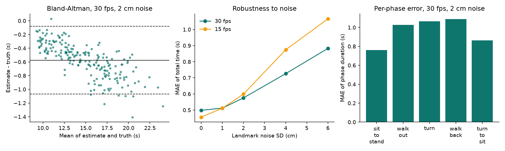

# Markerless timing of the Timed Up and Go test: algorithm, simulation study and a real-video case

**Hariharan S**, Department of Biomedical Engineering

## Abstract

**Background.** The Timed Up and Go (TUG) test is a standard fall-risk screen, scored with a
stopwatch as a single number. Video-based pose estimation could automate timing and add phase
and gait detail without sensors. **Objective.** To build a TUG analysis pipeline on a
general-purpose pose model and quantify its timing error. **Methods.** Joint angles from
MediaPipe Pose landmarks drive a rule-based segmentation into five phases. Because no open
video dataset with reference timings was available to us, accuracy was measured on a 3-D
kinematic simulator (2,000 tests; landmark noise 0 to 6 cm; 15 and 30 fps; 5% dropped frames),
and the full pipeline was run on one public demonstration video. **Results.** At 30 fps and 2 cm
noise the mean error was -0.57 s (95% limits of agreement -1.07 to -0.08 s), with 94.9%
sensitivity and 100% specificity at the 12-second cut-off. Error grew to -1.06 s at 15 fps and
6 cm noise. On the real clip the pipeline measured 12.5 s and 14 steps, but the pose model
confused the patient with an accompanying clinician in some frames. **Conclusion.** Total-time
measurement is robust in simulation with a consistent half-second underestimate; phase
boundaries and multi-person scenes need further work, and clinical validation is still required.

## 1. Introduction

Falls are a leading cause of injury in older adults. In the TUG test a person rises from a
chair, walks 3 m, turns, returns and sits. The CDC STEADI programme treats a time of 12 s or
more as indicating increased fall risk. The stopwatch score discards how the time was spent:
slow rising, slow turning and slow walking have different clinical meanings. Instrumented TUG
with inertial sensors recovers this detail but needs hardware. A phone camera does not.

## 2. Methods

**Pose estimation.** MediaPipe Pose Landmarker (full model), up to three people per frame,
3-D world landmarks in metres. When several people are detected the subject is initialised as
the most clearly seated person and followed by nearest predicted hip position.

**Posture signal.** Mean of bilateral knee (hip-knee-ankle) and hip (shoulder-hip-knee)
angles, smoothed with a 0.5 s Savitzky-Golay filter; about 100 degrees seated, 170 standing.

**Start and end.** The standing period is where posture exceeds 85% of its range. The test
starts at the last moment before rising where the rate of posture change is below 10% of its
peak, and ends at the first such moment after the descent. A level threshold alone was tried
first and lagged a smooth movement by about 0.4 s at each end.

**Turns.** For video, distance travelled from the chair is taken from sideways hip displacement
or, for a front view, change in apparent body height; the first turn surrounds the farthest
point and walking is where travel speed exceeds half its median. For pose-only input, turns
are 12% to 88% of a 180-degree change in body heading.

**Gait features.** Steps are peaks in ankle separation during walking phases; cadence is steps
per minute of walking; trunk lean is the angle of the hip-shoulder line from vertical.

**Simulator.** A stick figure (thigh 0.42 m, shank 0.43 m, trunk 0.50 m) performs the test with
minimum-jerk transitions, a sinusoidal gait cycle and 180-degree turns. Phase durations are
sampled to span brisk to frail performance (totals 6 to 30 s). Gaussian noise is added to
every landmark coordinate and frames are dropped at random.

**Metrics.** Bias and 95% limits of agreement (Bland-Altman), mean absolute error, Pearson r,
and sensitivity and specificity for the 12 s cut-off; 200 tests per condition.

## 3. Results

Full table: [RESULTS.md](RESULTS.md).

**Total time.** Bias was -0.46 to -0.60 s for noise up to 2 cm at either frame rate, rising to
-0.88 s (30 fps) and -1.06 s (15 fps) at 6 cm. No simulated test failed to analyse.

**Risk classification.** Specificity was 100% in every condition; sensitivity ranged from
92.2% to 97.3%. All errors were missed cases just above 12 s, the direct result of the
negative bias.

**Real video.** On the CDC clip (17 s, 24 fps) the subject was tracked in 98% of frames. The
pipeline placed the start at 52.3 s and the end at 64.8 s of the video (12.5 s total), which
agrees with frames inspected by eye (rising at 52.5 s, seated by 64.8 s). It counted 14 steps
(97 steps/min). Phase durations: sit-to-stand 0.4 s, walk out 3.3 s, turn 0.25 s, walk back
5.3 s, turn-and-sit 3.1 s. The turn duration is implausibly short.

## 4. Discussion

**The bias is systematic and explainable.** A smooth movement begins and ends with almost no
velocity, so its first and last tenth are indistinguishable from stillness. A fixed correction
of +0.5 s would centre the estimate in simulation, but applying a correction derived from
simulated motion to real patients is not justified without real reference data, so none is
applied and the bias is reported instead.

**Multi-person scenes.** The detector returned one skeleton per frame even with two people
in view, and that skeleton sometimes combined the clinician's torso with the patient's legs.
Total time survived because both people moved together. The recording protocol therefore
requires the patient alone in frame.

**Limitations.** The simulator shares modelling assumptions with the algorithm, so simulated
accuracy is an upper bound. Real pose noise is not Gaussian or independent between frames.
One real clip without a reference time is not validation. No participants with gait aids,
and no clinical outcomes.

**Future work.** Validation against stopwatch and instrumented-TUG references in older adults;
per-person tracking with a detector plus tracker; evaluation on the Toronto Older Adults Gait
Archive; learned phase segmentation.

## References

1. Podsiadlo D, Richardson S. The timed "Up & Go": a test of basic functional mobility for
   frail elderly persons. J Am Geriatr Soc. 1991;39(2):142-148.
2. Centers for Disease Control and Prevention. STEADI: Timed Up & Go (TUG) assessment.
3. Lugaresi C, et al. MediaPipe: a framework for building perception pipelines. 2019.
4. Bland JM, Altman DG. Statistical methods for assessing agreement between two methods of
   clinical measurement. Lancet. 1986;327(8476):307-310.
5. Mehdizadeh S, et al. The Toronto older adults gait archive. Sci Data. 2022;9:398.
